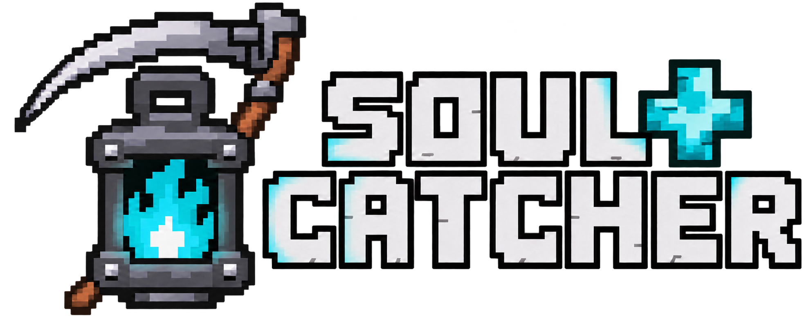

# Soul Catcher Plus

Capture the souls of defeated creatures and summon them as spectral companions.
Build your own collection, store soul energy in portable cages, and command your
companions in battle.

> **1.20.1 startup hotfix:** [Download hotfix 1](https://github.com/1PixelDemon1/soul-catcher-plus/releases/download/v1.2.2/soulcatcherplus-1.2.2%2B1.20.1-hotfix.1.jar) for Forge 47.4.28. It replaces the original 1.20.1 core JAR and fixes the Warden Mixin startup crash. See the [updated release notes](docs/releases/1.2.2.md).

## Features

- Mark enemies with a soul scythe and capture their souls after defeating them.
- Collect creature forms, browse 3D previews, and keep favorites at the top.
- Store soul energy in iron, diamond, netherite, and supreme soul cages.
- Summon spectral companions and give individual or group orders: follow, wait,
  guard, attack nearby enemies, or recall.
- Progress through four scythe tiers, custom enchantments, and advancements.
- Unlock Forgotten Souls: Raven collects items/souls, Courier opens each visitor's
  personal Ender Chest, and Shaman supplies support effects.
- Customize local soul color/opacity and read an optional English/Russian Patchouli guide.
- Extend creature support through a public API.

## Supported versions

**1.2.2** covers the core and Compat on all four targets below.
The core adds adapter-range/preview APIs and newer-platform companion corrections.
See the [release notes](docs/releases/1.2.2.md) for dependencies and validation.

| Minecraft | Mod loader | Java |
| --- | --- | --- |
| 1.16.5 | Forge 36.2.42 | 8 |
| 1.19.2 | Forge 43.5.0 | 17 |
| 1.20.1 | Forge 47.4.28 | 17 |
| 26.3 | Forge 66.1.0 | 25 |

Each Minecraft version has its own JAR. Install the matching core mod in the
`mods` folder on both client and server. The core does not require any creature
mods or animation libraries.

For dedicated creature-mod corrections, install the separate
[Soul Catcher Plus Compat addon](https://github.com/1PixelDemon1/soul-catcher-plus-compat)
on both sides with the matching core version. Creature mods and their libraries
are installed separately. Core builds do not load the addon's sources or JARs.
Each platform has its own artifacts and world/profile; no cross-version world
migration or universal creature-mod compatibility is promised.

## Quick start

Craft a soul scythe and a soul cage. Keep the cage in your offhand or hotbar,
mark an enemy with the scythe, defeat it, and collect its soul.

With a scythe in either hand, press **O** to open the collection or hold **R**
to open the command wheel. Both keys can be changed in Controls.

Patchouli is optional: guide baselines are **53.3** for 1.16.5, **77** for 1.19.2,
and **85** for 1.20.1. With it installed, receive a guide on first eligible login
or craft one from a book and soul sand. A compatible published Forge Patchouli
build has not been identified for 26.3; guide availability is not claimed there.


1.2.2 removes the core's artificial minimum Patchouli build. Install a build whose
own metadata matches the selected Minecraft/Forge version. The 53.3/77/85 examples
are historical development baselines, not hard minimums or fresh release results.
## Development

Primary 1.16.5 development uses Java 17 for Gradle/javac with compile-only Jabel,
and Java 8 for the game:

```powershell
python scripts/bootstrap.py
.\scripts\gradle.ps1 build -x test
.\scripts\gradle.ps1 runClient -PgameTests -PwithPatchouli
```

In this 1.16.5 example, `-PgameTests` enables the manual QA command; launching does
not execute tests. Integrations are developed separately in Compat. Use the
matching branch/toolchain on other platforms: Java 17 for 1.19.2/1.20.1 and Java 25
for 26.3. The 26.3 port uses native current APIs rather than loading an older JAR.

See the [extension API](docs/API.md) and [asset authoring guide](docs/ASSETS.md)
for development details. Generated previews and local reports are ignored;
approved model sources and editable pixel maps are kept in the repository.

## Repository branches

| Branch | Purpose |
| --- | --- |
| `main` | Release source and project overview |
| `develop` | Primary development for Forge 1.16.5 |
| `forge/1.19.2` | Forge 1.19.2 port |
| `forge/1.20.1` | Forge 1.20.1 port |
| `forge/26.3` | Forge 26.3 port; limited third-party integration availability |
| `archive/neoforge-1.20.4` | Archived experimental port; outside the current release |

See the [changelog](CHANGELOG.md) for release history and version-specific notes.
Historical release artifacts and notes retain their original requirements.

## Release validation

All four fresh core builds, archive audits, and dedicated-server startups passed;
servers saved/stopped normally with exit 0. The 1.16.5 core/Compat client completed
resource/sound/atlas startup with IAF, Twilight Forest, and Aquamirae. These are
build/load checks, not gameplay or multiplayer tests. No automated tests, GameTests,
or UI automation ran. See release notes for profiles and known external diagnostics.
## License

[MIT](LICENSE)
