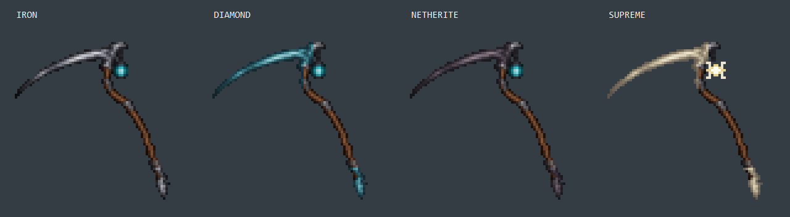
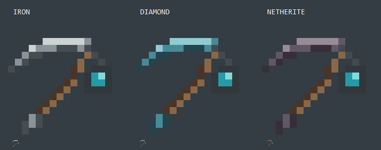
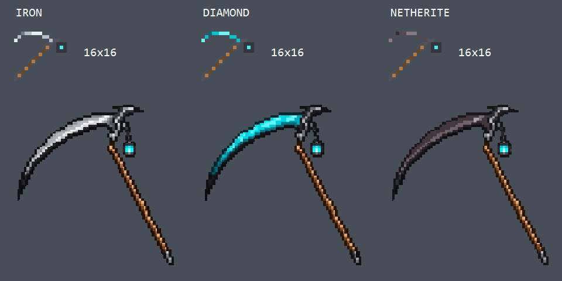

# Scythe artwork

## Current held family (1.16.5)



The approved **64x64** iron `soul_scythe.png` is the exact master for the held
family: modest curved wood, slender metal blade, cyan soul lantern and thorned
butt fitting. The diamond and netherite PNGs are palette variants of this master,
including both the blade and bottom fitting. Their alpha silhouette and wood,
lantern and intermediate collars match the iron master. Inventory icons are
16x16 adaptations of this family. Earlier preview sheets below predate this family.

`held-palettes.json` records the metal regions and five-tone material ramps.
`prepare_scythe_materials.ps1` maps iron luminance through those ramps without
resampling, moving or redrawing a pixel. The pommel recolor selects neutral metal
below its configured row, preserving the brown wood there.

`held-geometry.json` extends all three tails by repeating wooden source rows
41..46 into eight extra texel-sized geometry rows. The lower fitting shifts
rigidly eight texels down and three right. UVs keep sampling the original 64x64
sprites. All three generated closed meshes share the same geometry and thickness.

The shared `soul_scythe_held.json` uses a grip closer to the handle midpoint:
source texel center `(56.5,43.5)` becomes geometry point `(56.5,45.5)` after the
row extension. Third-person translation is `-16 * Ry(-90) * Rz(-27) * Scale(2,2,1)
* grip`, measured from the texture center with Y flipped. First-person translation
preserves the original `(0.27,-0.10,0)` grip anchor using the corresponding rotated
and scaled delta. The iron wrapper no longer overrides these shared hand poses.
Rotations, length scaling and one-model-pixel thickness remain unchanged; the new
grip still needs the user's check in-game.

The iron master was generated with the built-in `image_gen` tool and reduced to
64x64. Final iron prompt: preserve the moderate handle bend, thin iron blade,
enlarged cyan soul lantern and thorned pommel; use coarse Minecraft pixel clusters
and reduced metal/wood detail on transparency. Material palette trials also used
the built-in tool; the committed variants instead use the exact master and the
versioned palette file to preserve the requested layout.

Regenerate in this order on the Windows authoring host:

```powershell
./scripts/prepare_scythe_materials.ps1
./scripts/prepare_scythe_art.ps1
```

The packager preserves source dimensions up to 128x128 and rebuilds closed meshes.
These generated PNGs/JSONs are committed; a normal Gradle build does not need the
Windows artwork scripts. The preview is assembled from the mesh and texture,
not captured from Minecraft.

## Current inventory icons



`inventory.json` is the editable 16x16 pixel map. The small sprites retain the
clockwise crafting-recipe orientation while adopting the held family's curved
wood, slender blade, larger cyan lantern and pointed metal butt fitting. Blade
and butt fitting share each tier's muted material palette; wood and lantern
colors stay shared. These are deliberately drawn at 16x16, rather than downsampled
from the held textures, so the small shapes remain readable in the hotbar.
Run `python scripts/generate_assets.py` to rebuild the three runtime icons.

## Earlier artwork



The three designs use the user's approved wooden shaft, left-facing crescent
blade and hanging soul lantern. On held models, the cutting edge stays black;
the broad blade face changes to silver iron, cyan diamond or muted netherite.
Inventory icons use a thinner, single-pixel colored blade without the black band.
Their clockwise-rotated layout follows the crafting recipe: shaft from bottom-left
to upper-right, blade across the top and a compact, two-pixel-wide lantern at
the right. Its cyan area is two pixels high (2x2), with a narrow top cap and
a dark bottom rim. Shafts, fittings
and lantern colors share the same palette in inventory icons.

## Runtime assets

- `src/main/resources/assets/soulcatcherplus/textures/item/<item>.png`: exact
  **16x16** inventory sprite. `inventory.json` is the editable 16-row pixel map and
  RGBA palette, with shared colors and three blade-face palettes. The outline was
  simplified to keep a continuous shaft and readable lantern at this resolution.
- `<item>_held.png` in the same directory: **64x64**, packaged from the matching
  full-size source PNG in this folder. Nearest sampling and binary alpha keep the
  texture sharp and reduce unnecessary atlas and generated-geometry size.
- `models/item/<item>.json`: Forge `forge:separate_transforms` models choose the
  small icon for GUI, dropped items, frames and head display, and the detailed
  texture for held views. The old iron registry ID `soul_scythe` remains unchanged.
- `models/item/<item>_held_mesh.json`: generated, closed cuboids over opaque
  rectangles of that tier's texture. Identical runs in consecutive rows are
  merged; each UV stays between opaque texel centers. This replaces the generated
  item's alpha-cut full-square faces and separate boundary strips, whose UV
  contraction can expose seams at the silhouette. Thickness remains Z=7.5..8.5.
  Separate meshes preserve each source silhouette without changing the PNGs.
- `models/item/soul_scythe_held.json`: shared hand transforms and cutout rendering.
  In-plane scale is 2 in third person and 1.6 in first person. The thickness-axis
  scale is 1 in both views, keeping the Z=7.5..8.5 mesh one vanilla model pixel
  (1/16 block) thick. This does not change the silhouette or centered grip point.
  The user approved both view
  rotations and first-person framing. Only third-person translation was adjusted
  to `[0, 6.77, -6.25]` for a grip near the middle of the wood. With centered texture
  point `g=(0.27,-0.10,0)`, original rotation `Ry(-90) * Rz(-27)` and scale 2,
  `translation=-16 * R * Scale * g` puts that point at the standard hand anchor.
  Left-hand mirroring produces the same actual rotation, so the translation is
  shared. Native arm-layer translation must remain intact. The user confirmed
  the grip and seam correction in-game; the thinner depth has not yet been
  inspected in-game.

This uses Forge 47.4.28's built-in model loader and standard cuboid model elements.
No custom Java renderer or additional runtime dependency is required. Visual scale
does not change combat reach or attack attributes.

## Regenerating resources

Run `python scripts/generate_assets.py` from the project root after editing the
inventory map. This authors icons and the existing development GameTest arena;
it does not run Minecraft or tests.

On the Windows artwork host, run `./scripts/prepare_scythe_art.ps1` after replacing
a source PNG in this folder. It uses System.Drawing to package held textures and
author the matching closed meshes. Do not hand-edit the generated mesh JSONs.
These PNGs and JSONs are committed, so building the mod on another OS does not need the
Windows packaging script. Neither art script runs during a normal Gradle build.

`preview.png` is a presentation image only. It combines magnified inventory icons
and held textures; it is not an in-game screenshot.

## Generation provenance and prompts

The full-size PNG sources were edited using the built-in `image_gen` tool, not the
CLI. Reference: the approved wooden-shaft, left-facing sprite produced in this
conversation. No source assets from Minecraft or a third-party mod were copied.

Shared final edit prompt, followed by the material-specific instruction:

> Precise recolor edit of the attached approved Minecraft scythe sprite. Keep its silhouette, dimensions, wood handle, lantern, hanger, metal butt cap, pixel scale, position and composition IDENTICAL. The scythe blade points LEFT, wooden shaft extends down to lower RIGHT, hanging soul lantern is to the RIGHT of the joint. CRITICAL requested correction: the entire CUTTING EDGE, including the long curved lower edge formerly glowing cyan, must now be BLACK / very dark charcoal. No cyan glow or cyan stripe on the edge. It is the BROAD FLAT METAL FACE OF THE BLADE above the black cutting edge that changes material color. Keep the cyan fire ONLY inside the hanging lantern. Keep brown wooden handle and dark gray lantern frame untouched. Crisp simple low-resolution Minecraft pixel art, flat discrete color shading, hard square pixels, no gradients or antialiasing or bloom, no added ornament, no text. True transparent background and transparent holes preserved. Entire single sprite fits inside a square.

Iron:

> IRON BLADE: broad flat blade body is light cool silver iron, with medium steel-gray shadows and pale silver highlights. Cutting edge is solid near-black. Keep metal joint dark gray.

Diamond:

> DIAMOND BLADE: broad flat blade body is visibly diamond CYAN/TURQUOISE, like a vanilla Minecraft diamond sword blade, with dark teal body shadows and a few pale aqua face highlights. Do NOT leave the broad blade face gray or black. The cutting edge is an explicit solid near-BLACK band bordering the cyan blade face, never cyan. Keep metal joint dark gray.

Netherite:

> NETHERITE BLADE: broad flat blade face is muted Minecraft netherite dark gray-brown / subdued warm plum-gray, with a few lighter desaturated gray-violet highlights, visibly distinct from its near-black cutting edge. No vivid purple, no cyan anywhere on blade. Keep metal joint dark gray.

These prompts describe the final recolor. Runtime resizing and the exact 16x16
indexed icons are deterministic resource-authoring steps recorded above.
