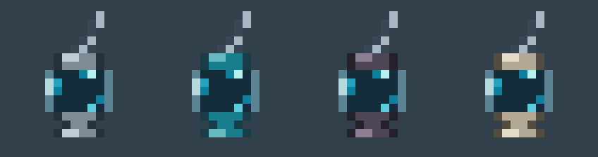

# Clean animated soul cages — Forge 1.16.5

Order: iron, diamond, netherite, supreme. Each runtime texture is a **16x64 RGBA**
strip of four **16x16** frames. The adjacent `.png.mcmeta` uses five ticks per
frame, indices 0–3, no interpolation: one loop per second.

The fixed vessel uses a compact palette instead of the earlier many near-identical
shades. A basket-like arched handle of alternating iron chain links connects to
both shoulders of the cage. This handle, glass highlights and frame remain fixed.
Three three-pixel soul wisps travel clockwise: a two-pixel luminous body and a
darker tail. Each wisp is 50% larger than the previous two-pixel design; distinct
head shades make the motion traceable. The space between them is fully transparent, including the opening in
the chain handle. Only the moving souls change the internal alpha footprint;
Minecraft's generated item model collects their edges across the animation frames.
Animation uses Minecraft's texture atlas, without an item renderer, entity scan,
Java tick handler or network traffic. Capacity, energy and the hand transforms
are unchanged. Empty cages keep the same decorative animation as filled cages.

The supreme cage uses a separate bone reliquary silhouette: pale jointed side
supports, a wider crown and splayed bone feet. A white-and-pale-gold Nether Star
ornament sits on the crown. Its transparent chamber and soul orbit use the same
coordinates as the other tiers, so the three souls remain unobstructed.

`sprites.json` is the editable pixel map, material palette and four orbit poses.
Optional `bodies` entries override only that material's stationary vessel.
Run `python scripts/prepare_cage_art.py` to export the runtime strips/metadata,
the individual frames and the enlarged static/APNG previews. The exporter uses
only the Python standard library; normal Gradle builds use committed resources.
Both enlarged previews preserve the transparent background and interior. The old
`concept-v1` images are retained as design history.

## Artwork provenance

The built-in `image_gen` tool was used for the cleaned animation concept.
Final concept prompt: preserve the compact glass vessel, three-link chain and
iron fittings; remove dither and noisy shading; use a few flat iron/glass tones
and three small cyan soul wisps rotating clockwise in four poses, while keeping
the frame stationary. Genuine transparency, crisp Minecraft pixel art, no text.

The production export uses the versioned pixel map to make every frame exactly
16x16, share one stationary body across all four poses and apply the four material
palettes consistently. The preview is exported from those same pixels and uses
the same timing as Minecraft, not recorded in-game footage.
