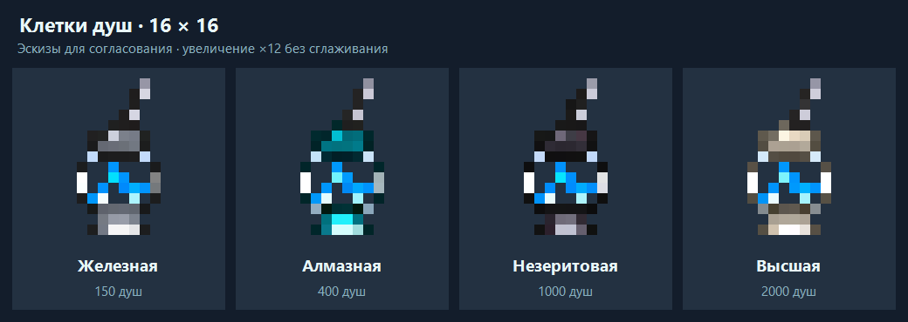

# Soul cage concepts — 16x16



Approved artwork used by the four soul cage items. Runtime copies are in
`src/main/resources/assets/soulcatcherplus/textures/item/<material>_soul_cage.png`.

| Sprite | Capacity | Frame material |
| --- | --- | --- |
| [iron.png](iron.png) | 150 soul energy | Silver-grey iron |
| [diamond.png](diamond.png) | 400 soul energy | Turquoise diamond |
| [netherite.png](netherite.png) | 1000 soul energy | Charcoal with grey-purple highlights |
| [supreme.png](supreme.png) | 2000 soul energy | Pale ivory bone; Nether Star motif |

Each individual sprite is exactly **16x16 RGBA** with binary transparency.
`preview.png` is a 12x nearest-pixel enlargement, not a runtime texture.
The design follows the user's glass-vessel sketch: intermediate-width glass
body, material-colored cap and foot, blue souls and a fine three-link iron chain.
At 16 pixels, links and the Nether Star motif use compact highlight clusters.

The artwork was generated and refined with the built-in `image_gen` tool.
[Prompts](prompts.md) record the final chain edit and material variations.

## Mechanics

- Soul energy moves from the character's ledger to item containers.
- A soul cage must be in the hotbar to capture a soul.
- Summoning spends the energy stored in that container.
- If several containers are in the hotbar, the leftmost one is used.
- Summon costs are not combined across containers; incoming rewards/refunds spill
  to the next hotbar cage when one fills up.
- Capacities are 150 / 400 / 1000 / 2000 as listed above.
- Old character energy is not transferred; the collection remains player-owned.

## Recipes

Iron and diamond use the following shaped layout:

```text
M C M
G S G
M M M
```

- `M`: the matching wall material, five pieces total.
- `C`: one chain.
- `G`: glass, two pieces total.
- `S`: soul sand.

The supreme cage uses bones for `M` and a Nether Star for `S`, keeping glass and
the chain in the same positions. Netherite upgrades a diamond cage through the
smithing table rather than using a separate shaped ingot recipe.

Netherite smithing requires its usual upgrade template and preserves the cage's
stored energy. New crafted cages start empty.
