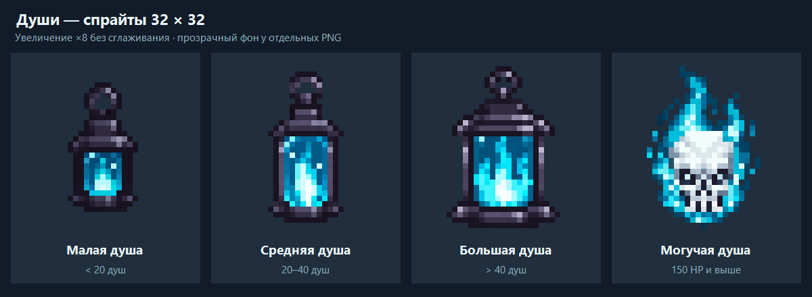

# Soul remnant artwork

Four approved sprites, each exactly **32x32 RGBA** with binary transparency:

| File | Appearance rule | Design |
| --- | --- | --- |
| `small.png` | Max HP below 150; victory energy below 20 | Compact dark-iron lantern, small cyan soul flame. |
| `medium.png` | Max HP below 150; victory energy 20–40 inclusive | Taller glass chamber, curved flame with an icy core. |
| `large.png` | Max HP below 150; victory energy above 40 | Broad reinforced lantern, three flame tips. |
| `skull.png` | Max HP 150 or above, regardless of energy | Pale skull with cyan embers, surrounded by blue soul fire. |

The shared lantern palette uses charcoal-purple metal, cyan, turquoise and icy
highlights. All sprites have transparent padding. `preview.png` is an 8x nearest
pixel enlargement for review, not a game texture.

Approved designs were generated with the built-in `image_gen` tool; the original
prompt set is in [prompts.md](prompts.md). The skull was initially requested as a
boss soul; the final gameplay rule uses max HP instead of boss classification.
Exports use nearest-pixel sampling and binary alpha, without smooth resizing.

Runtime copies are in
`src/main/resources/assets/soulcatcherplus/textures/entity/soul_remnant/`.
These are entity textures, not new inventory items. The renderer billboards them
toward the camera and keeps them visible in low light.
